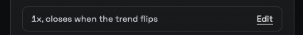
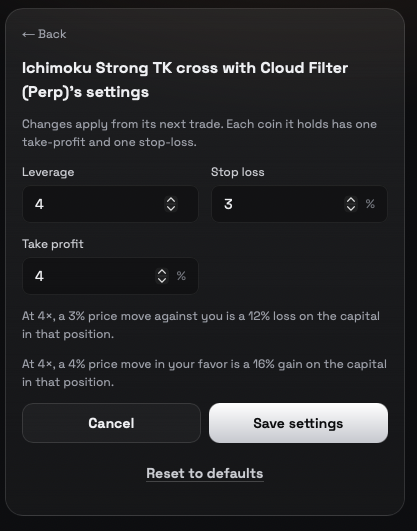

Every Fere agent runs its own unique strategy. You don't write prompts, code, or rules — you pick an agent whose strategy you like, give it money to trade with, and it gets to work around the clock.

<CardGroup cols={3}>
  <Card title="1. Pick an agent" icon="magnifying-glass">
    Browse the catalogue and open any agent to see what it trades and how it has performed.
  </Card>
  <Card title="2. Fund its wallet" icon="wallet">
    Each agent you start gets its own wallet. Add funds and it starts as soon as the money lands.
  </Card>
  <Card title="3. It trades, day and night" icon="clock">
    The agent follows its strategy on its own. Watch its trades and results anytime.
  </Card>
</CardGroup>

## The Agents Catalogue

Open **Agents** in the top navigation of the [Fere app](https://www.fereai.xyz/agents). The catalogue lists every agent you can start, grouped into categories you can filter by — for example memecoins, perps, or blue chips like ETH and BTC.

Once you're signed in, the agents you've already started appear at the top, along with a banner for your next step — for example **Start** an agent you've set up, or **Fund** one that's waiting for money.

## The Agent Page

Click any agent to open its page. You'll see:

- **What it does** — the strategy in plain language: what it trades, on which markets, and how it decides to exit.
- **Track record** — how the strategy has performed, plus its recent trades and wins.
- **Setup** — how much to deposit, the minimum it needs to start, its fees, and any settings you can adjust.

### Track record lists (before you deploy, or after you stop)

Memecoin and copy-trade agents show extra lists on that page:

- **Top picks** — the best calls in the **24H** or **7D** window. Five rows show first; **Show more** reveals the next five until every pick in that window is visible. Switching **24H** / **7D** resets the list to five again.
- **Latest calls** — recent buy calls with the reason for each. Five rows show first. **Show more** reveals calls already on the page, then loads older pages from the server (you'll see **Loading…** while that runs). There is no fixed cap — keep clicking until every call is shown and the button disappears.

Directional agents use **Show all** on closed trades when more than five closed rows are present (that list is already fully loaded on the page).

<Info>
  **Strategies are fixed.** Each agent's strategy is built and maintained by Fere — you can't change its logic. If you want a custom agent or want to run your own strategy, [contact us](/support).
</Info>

## How Backtests Work

A backtest replays a strategy's rules on past market data, factoring in things like token liquidity. Each strategy is tested over a period that suits it, and some come from TradingView, the community, or pro traders, tested over the windows they chose. To make results comparable, every backtest is **annualized**: converted to the yearly rate that would produce the same result. For example, +30% over 90 days is about +190% a year. Backtests aren't real trades and don't guarantee future results. We're continually improving how we backtest, so we can stress-test strategies more thoroughly.

## Settings You Can Adjust

Some agents let you tune a few settings before you start them, and while they run. Depending on the agent, these can include:

| Setting | What it changes |
| --- | --- |
| **Amount per trade** | How much the agent puts into each trade. |
| **Leverage** | How much leverage it uses (perps agents only). |
| **Stop loss** | How far a trade can fall before the agent exits. |
| **Take profit** | How far a trade can rise before the agent takes profit. |

Other agents run with fixed settings and show nothing to adjust — that's by design. Settings change the size and exits of each trade, never how often the agent trades. Each setting shows its allowed range, and a value outside it is saved as the nearest allowed value.

### Change Settings While It Runs

On the web, open the agent's page and choose **Edit** on the settings line under its wallet value. That line shows the amount per trade (if the agent has one), its leverage on perps agents, and its exits.

<Frame>
  
</Frame>

Set the values you want and choose **Save settings**. **Reset to defaults** puts back the agent's original settings. On a perps agent, the line under the stop loss and take profit shows what each one means for your money at the leverage you chose.

<Frame>
  
</Frame>

The settings line appears once the agent is running. An agent still waiting for its first deposit doesn't show it yet.

Changes apply from the agent's next trade. On a perps agent, a leverage change resizes open positions at the agent's next run. A stop loss or take profit is placed when the agent next opens or flips a position, so a position it already holds won't have one until then. A stop loss or take profit of 0 is off and shows as **Off**.

### Stop Loss and Take Profit With Leverage

On a perps agent with leverage, the stop loss and take profit are set on the coin's price, not on your money. Leverage multiplies that move. At 4×, a 5% price move against you is a 20% loss on the money in that position, and a 10% move in your favor is a 40% gain.

When an agent has a leverage setting, the line under its stop loss and take profit says what each one means for your money at the leverage you chose, and it updates as you change leverage. It uses the values that will be saved, so a leverage above the maximum is shown at the maximum, and on an agent whose leverage is a whole number, decimals are dropped (4.9× is saved and shown as 4×).

- **Stop loss at 100% or more of your money.** If the stop loss times the leverage reaches 100% (for example, 5% at 20×), the line says the position could be liquidated before the stop is reached.
- **Set to 0.** A stop loss or take profit of 0 is off, and no line is shown for it.
- **No leverage setting.** Spot agents show no line, because the percent already is the change in your money.

### How Stop Loss and Take Profit Follow a Perps Position

On a perps agent, the stop loss and take profit are placed on Hyperliquid when a position opens, measured from the price it opened at. They then follow the position as the agent trades:

- **The agent adds to a position.** The stop loss and take profit grow to cover the whole position, including what was just added. Their prices stay where they were.
- **The agent turns a long into a short (or the reverse).** The old stop loss and take profit are removed, and the new position gets its own, measured from the price it opened at.
- **The agent reduces a position.** The stop loss and take profit stay in place for what is left.
- **The agent closes a position.** Its stop loss and take profit are removed.
- **A stop loss or take profit closes a coin.** The agent leaves that coin out until its strategy gives a new signal for it, so it doesn't buy straight back into the same trade.

## Start an Agent

<Steps>
  <Step title="Open the agent">
    Pick an agent from the catalogue and review its page.
  </Step>
  <Step title="Adjust settings (if available)">
    Set the amount per trade, stop loss, and other options the agent allows.
  </Step>
  <Step title="Fund its wallet">
    The funding screen asks you to send the agent's **minimum plus $5**, and shows the minimum underneath. The extra covers fees and a stablecoin priced a cent under $1, so the deposit still clears the minimum when it lands. It also shows the networks you can send from and the wallet address for each. Minimums differ from agent to agent. If an agent's minimum is out of reach, its page may suggest a smaller agent with a similar strategy.

    A Hyperliquid agent's minimum also covers Hyperliquid's one-time **$1** activation fee and about **1%** to move the money onto Hyperliquid. For a $50 Hyperliquid account that is about **$52**, and the funding screen asks for **$57**. If a deposit falls short, the money stays in the agent's wallet and the page says how much more to add.
  </Step>
  <Step title="It goes live">
    The agent starts the moment enough money lands in its wallet. You'll get a message by email (or Telegram, if that's how you signed up) once it's live.
  </Step>
</Steps>

You can also choose **Fund later** — the agent waits until its wallet reaches the minimum, then starts on its own.

**Agents that trade on Hyperliquid.** After the money lands, Fere moves it onto Hyperliquid and connects the agent's trading key, so the agent shows **Starting** for a few minutes before it goes live. If Hyperliquid hasn't credited the transfer, Fere keeps checking for about two hours, waiting longer between each check. If it still isn't there, the agent stays on **Starting** and stops checking on its own. Adding more money to the agent's wallet starts the checks again. You can **Stop** the agent at any time while it's starting.

## Welcome email after onboarding

After you set up your first agent, Fere sends a welcome summary by email (and Telegram when you use that). The agent is **already deployed** — the primary button is **Fund**, not Deploy. That link opens the agent's page with the deposit panel ready (`/agents/{slug}?fund=1#fund`), so you can add money and let it start trading. The same deep link opens **Fund more** when the agent is already running.

## When a Fair Price Isn't Available

Some agents hold a basket of several stocks or tokens. Before each buy, the agent checks that it can get a fair price: for stocks and ETFs, close to the last market close, with a way to sell back out that wouldn't lose more than 5% right away. A small buy is priced at its own size, since the fixed cost of moving money between networks weighs more on a small order. If no market offers that, the agent skips that buy rather than overpay.

If the price moves past the limit between that check and the trade, the trade is cancelled before anything is sent, and its notification says how far the best quote was from the market price.

- **The money stays in Cash.** The agent doesn't pile the skipped amount into the other names. The rest of the basket keeps its intended weights, so the agent runs the same strategy with less of your money invested.
- **What it already holds stays.** If the agent already owns some of a skipped name, it keeps it and simply buys no more.
- **It tries again daily.** Skipped buys are retried once a day (stocks and ETFs during US market hours), up to 10 times, until they fill or the strategy next rebalances. A retry only buys the skipped names; it never sells anything else. If a name still can't be bought after the last retry, its money stays in Cash until the strategy's next rebalance.
- **You'll see why.** The run's details say how much is held in Cash and which names had no fair price, for example *"40.0% held in USDC: no fair price for CRM, WMT."*

Because an agent's track record assumes every buy filled, your agent can trail it a little on days when buys are skipped.

## Your Agent's Wallet and Cash

Every agent you start has its **own wallet**, secured by Coinbase. The agent can only trade with it — only you can withdraw. The money waiting to be traded shows as **Cash**, in US dollars. See [Wallet & Security](/wallet) for details.

- **Add more** — use **Fund more** on the agent's page anytime to top it up.
- **Withdraw** — choose **Withdraw**, enter an amount in USD, and the address to send it to.
- **Sell** — anything the agent holds can be sold back to Cash whenever you like.

## Stop or Restart

You're always in control.

- **Stop** — the agent stops making new trades. Whatever it holds stays in its wallet, and any take-profit and stop-loss orders it placed stay on. Sell or withdraw any of it whenever you like.
- **Start again** — restart a stopped agent from its page. If its wallet has dropped below the minimum, you'll be asked to fund it first (**Fund to start again**).

## Fees

| Agent type | Fee |
| --- | --- |
| Perps agents | **0.1%** of each trade |
| All other agents | **0.5%** of each trade |

There are no other fees from Fere.

## Track Your Agents

Open **Portfolio** in the top navigation to see every agent you've started in one place — what each one holds, its profit and loss, and a full history of its trades, deposits, and withdrawals.

Tokens worth under $2 and unverified tokens are hidden by default. See [Dust and unverified tokens](/wallet#dust-and-unverified-tokens).

<Warning>
  **Trading involves risk.** Agents trade real money in volatile markets, and past performance doesn't guarantee future results. Only fund an agent with money you can afford to lose.
</Warning>

## Want More Than the Catalogue?

- **Do your own research and trading** — connect Fere to Claude, ChatGPT, Codex, or any other AI client through our [MCP server](/mcp). It's live, and anyone can connect.
- **Want a custom agent, or have your own strategy?** If you want to use Fere AI for something custom or create your own strategies — or you're a KOL, influencer, or pro trader with a strategy you'd like to deploy — [get in touch](/support).
